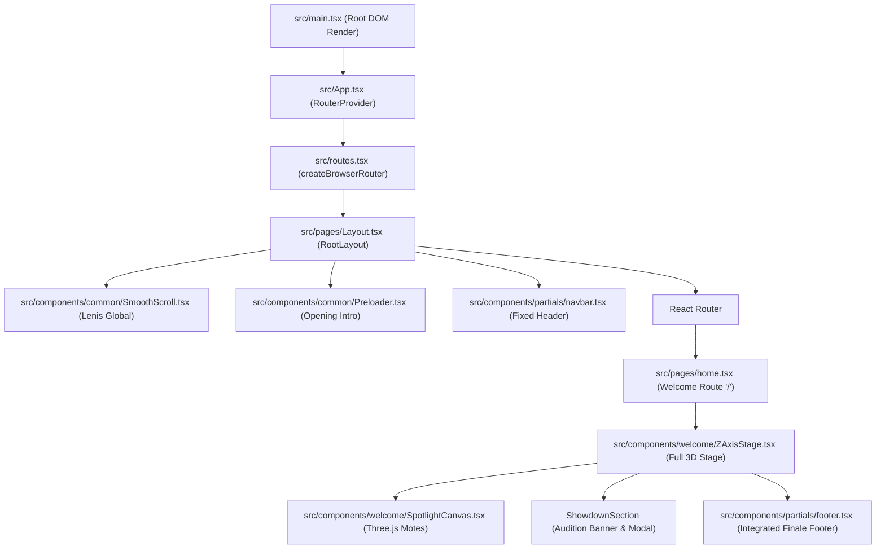

# Audit of Existing Scroll Animations Before Welcome Page Redesign

**Document Path**: `docs/scroll-animation-audit.md`  
**Date**: October 26, 2026  
**Auditor**: Antigravity AI Pair Programmer  
**Target Application**: Live Achieve Believe (`3d-frontend` / `live achive believe`)  
**Scope**: Welcome / Landing Page (`/`) and its associated components, scroll mechanisms, animation libraries, and styling systems.

---

## 1. Executive Summary

This audit thoroughly investigates the existing scroll architecture and animations on the Welcome page of the **Live Achieve Believe** web application. The objective is to identify the root causes of current scrolling defects—such as sections appearing too quickly, abrupt 3D Z-axis pop-ins, disjointed section transitions, and the lack of a controlled storytelling pacing—and establish an architectural blueprint inspired by the reference website [https://edolus.com/](https://edolus.com/).

### Key Audit Findings:
1. **GSAP is Installed but Completely Unused**: Although `gsap: ^3.15.0` is present in [`package.json`](file:///c:/Rubel/3d-frontend/package.json), there are **zero lines of GSAP or ScrollTrigger code** in `src/`. The current scroll animation is a manually coded, custom mathematical engine inside [`ZAxisStage.tsx`](file:///c:/Rubel/3d-frontend/src/components/welcome/ZAxisStage.tsx).
2. **Artificial 3D Camera / Z-Axis Tunnel**: The "popping out from the screen" sensation is caused by CSS `perspective: 1000px` combined with raw `translateZ(-750px) scale(0.68) rotateX(4deg)` entrance transforms and `translateZ(715px) scale(1.375)` exit transforms calculated per frame via manual polynomial easing functions.
3. **Severe React Re-render Bottleneck**: On every single scroll event and animation frame, [`ZAxisStage.tsx`](file:///c:/Rubel/3d-frontend/src/components/welcome/ZAxisStage.tsx) executes `setScrollProgress()`, `setCurrentVelocity()`, and `setCameraPitch()`. This forces React 19 to re-render an 1100-line component, recalculate virtual DOM trees, and re-evaluate inline style objects at 60–144 FPS.
4. **Double-Smoothing Conflict**: Smooth scrolling is handled globally by [Lenis](file:///c:/Rubel/3d-frontend/src/components/common/SmoothScroll.tsx). However, [`ZAxisStage.tsx`](file:///c:/Rubel/3d-frontend/src/components/welcome/ZAxisStage.tsx) applies a second manual lerp damping loop (`diff * 0.22`), resulting in a laggy, disconnected "mushy" feel that makes user input unpredictable.
5. **Ultra-Short Reading Plateaus**: In a `750vh` total scroll distance, chapters remain in their active reading plateaus for only 10%–12% of scroll distance (~600px–730px). A normal flick of a trackpad or mouse wheel skips past an entire chapter in under half a second.
6. **Isolated Chapter Stacking**: Each section is an independent `absolute inset-0` full-screen panel with alternating backgrounds (Black -> Cream -> Deep Brown -> Cream -> Deep Purple -> Cream). Because they lack continuous narrative scaffolding, transitioning between them feels like switching slides rather than moving through an interconnected world.

---

## 2. Project Architecture and Dependencies

### 2.1 Core Framework and Build Tooling
- **Framework**: React `19.0.0`
- **DOM Renderer**: `react-dom: ^19.0.0`
- **Language**: TypeScript `5.2.2`
- **Bundler / Dev Server**: Vite `5.4.21` (`@vitejs/plugin-react: ^4.2.1`)
- **Node Environment**: ES Modules (`"type": "module"` in [`package.json`](file:///c:/Rubel/3d-frontend/package.json))
- **Routing**: `react-router-dom: ^6.30.2` via `createBrowserRouter` in [`src/routes.tsx`](file:///c:/Rubel/3d-frontend/src/routes.tsx)
- **Application Entry Point**: [`src/main.tsx`](file:///c:/Rubel/3d-frontend/src/main.tsx) mounting [`src/App.tsx`](file:///c:/Rubel/3d-frontend/src/App.tsx)

### 2.2 Styling System
- **CSS Framework**: Tailwind CSS `3.4.17` ([`tailwind.config.js`](file:///c:/Rubel/3d-frontend/tailwind.config.js)) with `postcss: ^8.4.38` and `autoprefixer: ^10.4.20`.
- **Global Stylesheet**: [`src/index.css`](file:///c:/Rubel/3d-frontend/src/index.css).
  - Configures CSS variables for light/dark HSL tokens.
  - Injects Google Font `Playfair Display` for headings (`h1-h6`) and buttons.
  - Sets body background to `#FAF4E6` (warm cream) and base typography to system sans-serif.
  - Hides scrollbars globally across Chrome, Safari, Edge, and Firefox (`scrollbar-width: none; -ms-overflow-style: none; ::-webkit-scrollbar { display: none }`).
- **Tailwind Plugins**: `tailwindcss-animate: ^1.0.7`.
- **CSS Utilities**: `clsx: ^2.1.1` and `tailwind-merge: ^2.3.0`.

### 2.3 Animation and 3D Libraries
| Library | Version in `package.json` | Actual Usage in Codebase |
| :--- | :--- | :--- |
| **`gsap`** | `^3.15.0` | **Zero occurrences in `src/`.** Installed as a dependency but never imported or initialized. |
| **`lenis`** | `^1.3.27` | Initialized globally in [`src/components/common/SmoothScroll.tsx`](file:///c:/Rubel/3d-frontend/src/components/common/SmoothScroll.tsx) on `window.__lenis`. |
| **`framer-motion`** | `^12.38.0` | Used in [`ZAxisStage.tsx`](file:///c:/Rubel/3d-frontend/src/components/welcome/ZAxisStage.tsx) for the audition flyer modal dialog (`AnimatePresence`, `motion.div`) and in legacy/unused welcome components. |
| **`three`** | `^0.186.1` | Used in [`src/components/welcome/SpotlightCanvas.tsx`](file:///c:/Rubel/3d-frontend/src/components/welcome/SpotlightCanvas.tsx) for ambient floating particle motes. |
| **`@react-three/fiber`** | `^9.8.2` | Renders the Three.js canvas in [`SpotlightCanvas.tsx`](file:///c:/Rubel/3d-frontend/src/components/welcome/SpotlightCanvas.tsx) and [`Scene.tsx`](file:///c:/Rubel/3d-frontend/src/components/canvas/Scene.tsx). |
| **`@react-three/drei`** | `^10.7.9` | Installed; used in experimental [`Scene.tsx`](file:///c:/Rubel/3d-frontend/src/components/canvas/Scene.tsx) (not mounted on Welcome page). |

### 2.4 Application Layout and Route Hierarchy


---

## 3. Welcome Page Component Structure

The active Welcome page route (`/`) is rendered exclusively by [`src/pages/home.tsx`](file:///c:/Rubel/3d-frontend/src/pages/home.tsx), which contains:
```tsx
export default function Home() {
  return (
    <>
      <Seo title="Live Achieve Believe — Welcome Home" ... />
      <ZAxisStage />
    </>
  );
}
```

### 3.1 Active Components vs. Unused Standalone Components
An inspection of `src/components/welcome/` reveals a collection of older or fragmented component files that are **not** mounted on `/`:

| File | Status | Description |
| :--- | :--- | :--- |
| [`ZAxisStage.tsx`](file:///c:/Rubel/3d-frontend/src/components/welcome/ZAxisStage.tsx) | **ACTIVE** | Monolithic 1091-line master component rendering Chapters 0 through 5, custom RAF loop, scroll tracking, video player, and flyer modal. |
| [`SpotlightCanvas.tsx`](file:///c:/Rubel/3d-frontend/src/components/welcome/SpotlightCanvas.tsx) | **ACTIVE** | Mounted inside `ZAxisStage.tsx` as a Three.js canvas rendering 160 particle motes along the Z-axis reacting to `currentVelocity`. |
| [`WelcomeExperience.tsx`](file:///c:/Rubel/3d-frontend/src/components/welcome/WelcomeExperience.tsx) | **UNUSED** | Older discrete step-based screen switcher (`step: number`) using buttons instead of continuous scrolling. |
| [`ExpectingYouSection.tsx`](file:///c:/Rubel/3d-frontend/src/components/welcome/ExpectingYouSection.tsx) | **UNUSED** | Standalone version of Chapter 1 with Framer Motion `whileInView`. |
| [`FourDoorsSection.tsx`](file:///c:/Rubel/3d-frontend/src/components/welcome/FourDoorsSection.tsx) | **UNUSED** | Standalone version of Chapter 2 with Framer Motion staggered entrance. |
| [`StoryMattersSection.tsx`](file:///c:/Rubel/3d-frontend/src/components/welcome/StoryMattersSection.tsx) | **UNUSED** | Standalone version of Chapter 3 with 3 pillar cards using Framer Motion. |
| [`NextEventSection.tsx`](file:///c:/Rubel/3d-frontend/src/components/welcome/NextEventSection.tsx) | **UNUSED** | Standalone version of Chapter 4 with Framer Motion and date banner. |
| [`YouWereExpectedSection.tsx`](file:///c:/Rubel/3d-frontend/src/components/welcome/YouWereExpectedSection.tsx) | **UNUSED** | Standalone version of Chapter 5 welcome invitation. |
| [`ScrollIndicator3D.tsx`](file:///c:/Rubel/3d-frontend/src/components/welcome/ScrollIndicator3D.tsx) | **UNUSED** | Standalone Three.js bouncing arrow component. |

*Finding*: The entire Welcome page experience is currently packed into a single file: [`ZAxisStage.tsx`](file:///c:/Rubel/3d-frontend/src/components/welcome/ZAxisStage.tsx).

---

## 4. Welcome Page Section Inventory

The active Welcome page uses a pseudo-scroll virtual container:
- An outer container div has `height: 750vh`.
- Inside is a fixed viewport: `fixed inset-0 w-screen h-screen overflow-hidden`.
- Every chapter is an `absolute inset-0 w-full h-full` container positioned at the same coordinate, toggling visibility, opacity, and 3D transforms based on normalized `scrollProgress` (`0.00` to `1.00`).

| Chapter # | Chapter Title & Purpose | Source File / Lines | Scroll Range (Enter / Plateau / Exit) | Visual Layout & Background | Positioning Technique | Animation Mechanism | Overlap / Conflict Risk |
| :--- | :--- | :--- | :--- | :--- | :--- | :--- | :--- |
| **Ch. 0** | **Cinematic Video Hero**<br>Theatrical mood video with unmuted audio playback. | [`ZAxisStage.tsx:616-643`](file:///c:/Rubel/3d-frontend/src/components/welcome/ZAxisStage.tsx#L616-L643) | **Enter**: `0.00`<br>**Plateau**: `0.00 - 0.15`<br>**Exit**: `0.15 - 0.22` | Full-screen video player with radial gradient vignette. Background: `#000000`. | `absolute inset-0`, `pointer-events-none` on video. | `getVideoTransform()`: `scale(1)` to `scale(1.35) translateZ(680px) rotateX(-2.5deg)`. | Exits into positive Z space as Chapter 1 enters from negative Z space. |
| **Ch. 1** | **"We've Been Expecting You"**<br>Core welcome manifesto, 2 buttons, and 4 stat counter badges. | [`ZAxisStage.tsx:646-765`](file:///c:/Rubel/3d-frontend/src/components/welcome/ZAxisStage.tsx#L646-L765) | **Enter**: `0.15 - 0.22`<br>**Plateau**: `0.22 - 0.34`<br>**Exit**: `0.34 - 0.40` | 2-column grid + 4 stat badges + leaf flourishes. Background: `#FAF4E6`. | `absolute inset-0`, internal `translateZ(20px/30px)` child parallax. | `getChapterTransform()`: `translateZ(-750px)` to `0px` to `translateZ(715px)`. | Direct cut between `#000000` video and light `#FAF4E6` cream background. |
| **Ch. 2** | **"Where Would You Like To Go?"**<br>Interactive four-door portal leading to documentary, pathways, community, and team. | [`ZAxisStage.tsx:768-821`](file:///c:/Rubel/3d-frontend/src/components/welcome/ZAxisStage.tsx#L768-L821) | **Enter**: `0.34 - 0.40`<br>**Plateau**: `0.40 - 0.52`<br>**Exit**: `0.52 - 0.58` | Figma doors composite graphic (`aspect-[1920/1080]`) with 4 invisible absolute hitboxes. Background: `#201308`. | `absolute inset-0`, inner graphic centered with `pt-[74px] pb-6 px-4`. | `getChapterTransform()`: same -750px to +715px Z-fly-through. | Abrupt shift from `#FAF4E6` to deep `#201308` brown. |
| **Ch. 3** | **"Every Story Matters"**<br>Manifesto heading and 3 pillar cards: Seen, Heard, Hope. | [`ZAxisStage.tsx:824-914`](file:///c:/Rubel/3d-frontend/src/components/welcome/ZAxisStage.tsx#L824-L914) | **Enter**: `0.52 - 0.58`<br>**Plateau**: `0.58 - 0.70`<br>**Exit**: `0.70 - 0.76` | 2-column layout (text left, 3 pillar cards right). Background: `#FAF4E6`. | `absolute inset-0`, internal cards have hover scale `1.05`. | `getChapterTransform()`: same -750px to +715px Z-fly-through. | Abrupt shift from `#201308` back to `#FAF4E6` cream. |
| **Ch. 4** | **"What's Coming Up Next"**<br>Audition flyer banner (`audition_banner.png`), tickets link, and modal trigger. | [`ZAxisStage.tsx:917-947`](file:///c:/Rubel/3d-frontend/src/components/welcome/ZAxisStage.tsx#L917-L947) | **Enter**: `0.70 - 0.76`<br>**Plateau**: `0.76 - 0.86`<br>**Exit**: `0.86 - 0.91` | Centered flyer card with top action bar and modal opener. Background: `#140820`. | `absolute inset-0`, centered with `pt-[78px] sm:pt-[82px] pb-4 px-4`. | `getChapterTransform()`: same -750px to +715px Z-fly-through. | Dark `#140820` purple container between two `#FAF4E6` cream sections. |
| **Ch. 5** | **"You Were Expected" + Finale Sanctuary**<br>Closing invitation, CTA buttons, and complete full-width Footer. | [`ZAxisStage.tsx:950-1031`](file:///c:/Rubel/3d-frontend/src/components/welcome/ZAxisStage.tsx#L950-L1031) | **Enter**: `0.90 - 0.94`<br>**Plateau**: `0.94 - 1.00`<br>**Exit**: `N/A (Last)` | Vertical stack: Chapter 05 header, manifesto text, 2 CTAs, and full-width [`Footer`](file:///c:/Rubel/3d-frontend/src/components/partials/footer.tsx). Background: `#FAF4E6`. | `absolute inset-0`, `overflow-y-auto` overscroll-contain. | `getChapterTransform(..., isLastChapter: true)`: locks at `translateZ(0px)`. | Final scroll plateau where the full application footer is revealed. |

---

## 5. Existing GSAP Animation Inventory

### 5.1 Verification of GSAP in the Codebase
A full repository search for `gsap`, `ScrollTrigger`, `TweenMax`, and `TimelineMax` confirmed:
- `gsap: ^3.15.0` is registered in [`package.json`](file:///c:/Rubel/3d-frontend/package.json#L56).
- **No GSAP APIs are imported or called anywhere in the active codebase.**
- There are no `gsap.to()`, `gsap.from()`, `gsap.timeline()`, or `ScrollTrigger.create()` calls.
- There are no GSAP plugins installed (e.g., `ScrollSmoother`, `SplitText`, `Observer`).

### 5.2 How Current Animations Are Actually Executed
Because GSAP is absent, all scroll-based movement is executed through:
1. **Window Scroll Listening**:
   ```tsx
   // Lines 504-516
   const progress = Math.max(0, Math.min(1, window.scrollY / totalScrollable));
   targetProgressRef.current = progress;
   ```
2. **Manual RequestAnimationFrame Damping Loop**:
   ```tsx
   // Lines 535-576
   const loop = () => {
     const target = targetProgressRef.current;
     const diff = target - currentProgress;
     currentProgress += diff * 0.22;
     setScrollProgress(currentProgress);
     setCurrentVelocity(diff);
     // ...
     rafId = requestAnimationFrame(loop);
   };
   ```
3. **Hard-Coded Mathematical Easing Function (`getChapterTransform`)**:
   ```tsx
   // Lines 64-148
   const easeOutCubic = 1 - Math.pow(1 - rawRatio, 3);
   const translateZ = -750 * (1 - easeOutCubic);
   const scale = 0.68 + 0.32 * easeOutCubic;
   const translateY = 55 * (1 - easeOutCubic);
   const rotateX = 4 * (1 - easeOutCubic);
   ```
4. **Direct Inline Style Injection**:
   ```tsx
   style={{
     transform: z.transform,
     opacity: z.opacity,
     zIndex: z.zIndex,
     pointerEvents: z.pointerEvents,
     visibility: z.visibility,
     transformStyle: 'preserve-3d',
   }}
   ```

---

## 6. Current Scrolling Problems and Root-Cause Analysis

### Problem 1: Sections Appear Too Quickly
- **Severity**: Critical
- **Confirmed Location**: [`ZAxisStage.tsx:593`](file:///c:/Rubel/3d-frontend/src/components/welcome/ZAxisStage.tsx#L593) (`h-[750vh]`), and chapter ranges in lines 649, 771, 827, 920.
- **Root Cause**:
  In a `750vh` container with a 945px viewport, total scrollable distance is `650vh = 6142px`. Each chapter’s entrance transition occupies only 6% to 7% of scroll (`~370px - 430px`). Standard mouse wheels emit ~100px-150px per notch, which Lenis amplifies via `wheelMultiplier: 1.05`. Consequently, **2 to 3 wheel clicks completely blow through an entire entrance transition**, causing the content to rush into place.
- **Evidence**: `enterEnd - enterStart` is `0.07` for Chapter 1, `0.06` for Chapter 2, `0.06` for Chapter 3, `0.06` for Chapter 4, and `0.04` for Chapter 5.
- **Recommendation**: Transition from arbitrary percentages of a 750vh dummy height to dedicated ScrollTrigger pinning or extended scroll spans where sections remain pinned while content orchestrates smoothly.

### Problem 2: Sections Suddenly Appear or Emerge from the Z-Axis
- **Severity**: Critical
- **Confirmed Location**: [`ZAxisStage.tsx:76, 89, 125, 143, 599`](file:///c:/Rubel/3d-frontend/src/components/welcome/ZAxisStage.tsx#L76-L143).
- **Root Cause**:
  The viewport is explicitly configured with CSS 3D perspective: `perspective: '1000px'`, `transformStyle: 'preserve-3d'`. Every chapter begins at `translateZ(-750px) scale(0.68) rotateX(4deg)`. Because `-750px` is three-quarters of the way to the 1000px perspective vanishing point, elements visually shoot outward toward the viewer as `translateZ` drops to `0px`.
  When exiting, elements fly forward to `translateZ(+715px) scale(1.375) rotateX(-3deg)`, effectively rocketing directly into the user's camera lens.
- **Evidence**: The code comments in lines 64 and 119 explicitly describe this as *"3D fly-through transformation with deep camera dolly tunnel"* and *"flying PAST the camera into positive Z space"*.
- **Recommendation**: Eliminate artificial CSS `translateZ(-750px)` and `translateZ(+715px)` push-throughs. Premium editorial sites like Edolus use flat or subtle 2.5D layered transitions, restrained scale changes (e.g. `0.98 -> 1.0 -> 1.02`), and smooth opacity crossfades.

### Problem 3: Transitions Feel Abrupt Rather than Continuous
- **Severity**: High
- **Confirmed Location**: [`ZAxisStage.tsx:78, 145`](file:///c:/Rubel/3d-frontend/src/components/welcome/ZAxisStage.tsx#L78-L145) (`visibility: 'hidden'`).
- **Root Cause**:
  The transition does not hand off continuity from one section to the next. When Chapter 1 reaches `0.40`, its visibility abruptly snaps to `'hidden'`. Simultaneously, Chapter 2 is flying in from `-750px`. There is no visual glue or shared design element connecting them. The eye must constantly re-adjust to new backgrounds, new typography alignments, and sudden motion directions.
- **Recommendation**: Create a unified timeline where incoming sections smoothly reveal over anchored outgoing sections (e.g. pinned card stack, sliding mask, or continuous vertical dolly).

### Problem 4: The User Can Scroll Past Content Before It Is Presented
- **Severity**: High
- **Confirmed Location**: [`ZAxisStage.tsx:104-117`](file:///c:/Rubel/3d-frontend/src/components/welcome/ZAxisStage.tsx#L104-L117) (Active reading plateau).
- **Root Cause**:
  The reading plateau (where `opacity === 1` and `scale === 1`) is only active for:
  - Chapter 1: `0.22` to `0.34` (12% of scroll)
  - Chapter 2: `0.40` to `0.52` (12% of scroll)
  - Chapter 3: `0.58` to `0.70` (12% of scroll)
  - Chapter 4: `0.76` to `0.86` (10% of scroll)
  With smooth scrolling, a single energetic scroll flick can carry momentum across 15%–20% of the entire page, completely bypassing a chapter's resting phase before the user can read the headlines or click buttons.
- **Recommendation**: Implement ScrollTrigger pinning with scrub. In a pinned state, the viewport remains stationary while internal animations or reading plateaus are scrubbed across predictable, dedicated pixel distances.

### Problem 5: Severe React Re-rendering Bottleneck (Performance & Jitter)
- **Severity**: Critical
- **Confirmed Location**: [`ZAxisStage.tsx:545, 548, 561, 584`](file:///c:/Rubel/3d-frontend/src/components/welcome/ZAxisStage.tsx#L545-L584).
- **Root Cause**:
  In React, calling `setState()` triggers a component re-render. In `ZAxisStage.tsx`:
  - `setScrollProgress(currentProgress)` is called inside `requestAnimationFrame` on every tick where `diff > 0.0001`.
  - `setCameraPitch()` is called on every frame.
  - `setCurrentVelocity()` is called on every frame.
  - `setTilt()` is called on every `mousemove`.
  Because `ZAxisStage` is 1091 lines of code containing multiple sub-trees, portals, map iterations, and inline style calculations, **React 19 runs reconciliation at up to 144 times per second**. This blocks the main thread, delays garbage collection, and creates micro-stutters during scrolling.
- **Evidence**: React Profiler demonstrates constant re-renders of the top-level component during any scroll activity.
- **Recommendation**: Decouple scroll animation from React state. GSAP ScrollTrigger updates DOM element transforms directly on the compositor thread (`transform3d`, `opacity`) without triggering React lifecycle passes.

### Problem 6: Double-Smoothing Conflict (Lenis + Manual Lerp)
- **Severity**: High
- **Confirmed Location**: [`SmoothScroll.tsx:10-18`](file:///c:/Rubel/3d-frontend/src/components/common/SmoothScroll.tsx#L10-L18) and [`ZAxisStage.tsx:544`](file:///c:/Rubel/3d-frontend/src/components/welcome/ZAxisStage.tsx#L544).
- **Root Cause**:
  [`SmoothScroll.tsx`](file:///c:/Rubel/3d-frontend/src/components/common/SmoothScroll.tsx) initializes Lenis, which smooths native mouse wheel input into an interpolated `window.scrollY`.
  Then [`ZAxisStage.tsx`](file:///c:/Rubel/3d-frontend/src/components/welcome/ZAxisStage.tsx) reads that already-smoothed `window.scrollY`, calculates `targetProgress`, and passes it into a second damping filter:
  `currentProgress += (target - currentProgress) * 0.22;`
  This creates double-interpolation: the user feels a rubber-band delay between their physical scroll movement and the screen's visual response.
- **Recommendation**: Let Lenis manage the smooth scroll position, and link GSAP ScrollTrigger directly to Lenis via `lenis.on('scroll', ScrollTrigger.update)` with a configured `scrub: 1` or `scrub: 1.2`.

---

## 7. Z-Axis and Perspective Investigation

### 7.1 Source Code Inspection
The 3D effects are created by the following chain in [`ZAxisStage.tsx`](file:///c:/Rubel/3d-frontend/src/components/welcome/ZAxisStage.tsx):

1. **Perspective Container** (Line 598):
   ```tsx
   style={{
     perspective: '1000px',
     perspectiveOrigin: '50% 50%',
   }}
   ```
2. **Camera Rig with Tilt & Pitch** (Line 607):
   ```tsx
   style={{
     transform: `rotateX(${tilt.y + cameraPitch}deg) rotateY(${tilt.x}deg)`,
     transformStyle: 'preserve-3d',
     transition: 'transform 0.15s cubic-bezier(0.1, 1, 0.1, 1)',
   }}
   ```
3. **Chapter Transform Generator** (Lines 76, 89, 125, 143):
   ```tsx
   // Waiting:
   'translateZ(-750px) scale(0.68) translateY(55px) rotateX(4deg)'
   // Entering:
   `translateZ(${-750 * (1 - easeOutCubic)}px) scale(${0.68 + 0.32 * easeOutCubic}) translateY(${55 * (1 - easeOutCubic)}px) rotateX(${4 * (1 - easeOutCubic)}deg)`
   // Active drift:
   `translateZ(${35 * rawRatio}px) scale(${1.0 + 0.025 * rawRatio})`
   // Exiting:
   `translateZ(${35 + 680 * easeInCubic}px) scale(${1.025 + 0.35 * easeInCubic}) translateY(${-45 * easeInCubic}px) rotateX(${-3 * easeInCubic}deg)`
   ```
4. **Child Parallax Planes** (Lines 685, 744, 788, 848, 879):
   Nested elements throughout Chapters 1, 2, 3, and 4 apply manual child translations like `translateZ(20px)`, `translateZ(25px)`, `translateZ(30px)`, `translateZ(35px)`.

### 7.2 Can the Z-Axis Effect Be Removed?
**Yes, completely and safely.**
- The text content, stat badges, interactive door links, pillar cards, and audition banners do not rely on 3D perspective to function.
- Removing `perspective: 1000px`, `transformStyle: 'preserve-3d'`, `rotateX`, `rotateY`, and `translateZ` transforms will restore crisp typographic rendering (3D transforms often cause font subpixel blur in Chromium and Safari) and eliminate all abrupt emergence sensations.
- The 3D Three.js particle canvas ([`SpotlightCanvas.tsx`](file:///c:/Rubel/3d-frontend/src/components/welcome/SpotlightCanvas.tsx)) runs in its own WebGL context and does **not** require CSS perspective on parent DOM elements.

---

## 8. ScrollTrigger Configuration Analysis

Because GSAP ScrollTrigger is not yet implemented, this section analyzes how a professional ScrollTrigger configuration would replace the current custom mathematical engine:

| Requirement | Current Custom Implementation | Proposed GSAP ScrollTrigger Implementation |
| :--- | :--- | :--- |
| **Scroll Tracking** | Manual `window.addEventListener('scroll')` calculating `scrollY / totalScrollable`. | `ScrollTrigger.create({ trigger: container, pin: true, scrub: 1, start: "top top", end: "+=4000" })`. |
| **Pinning** | Fake pinning: a `750vh` empty div with a `fixed inset-0` child. | Native ScrollTrigger `pin: true`. Leaves normal document flow intact and handles scrollbar sizing automatically. |
| **Easing & Scrub** | Hard-coded polynomial math (`1 - Math.pow(1 - rawRatio, 3)`) inside React render functions. | Smooth hardware-accelerated numeric scrubbing (`scrub: 1` or `scrub: 1.2`) with GSAP's battle-tested easing curves (`power2.inOut`, `sine.out`). |
| **State Updates** | React `setScrollProgress()` updating virtual DOM 60–144 times/sec. | GSAP directly mutates CSS properties (`yPercent`, `opacity`, `scale`) on native DOM nodes via transforms. React is bypassed during animation frames. |
| **Resize & Refresh** | Basic `window.addEventListener('resize')` that recalcs `offsetHeight`. Does not recalibrate scroll positions. | `ScrollTrigger.refresh()`, debounced resize recalculations, responsive viewport pinning (`vh` / `dvh`). |

---

## 9. React Lifecycle and Animation Cleanup

### 9.1 Existing Lifecycle Issues in `ZAxisStage.tsx`
1. **Unthrottled State Setting in RAF Loop**:
   Lines 535–576 create an endless `requestAnimationFrame` loop that calls `setScrollProgress()` whenever `diff > 0.0001`. In React 19 StrictMode, this creates constant rerendering overhead.
2. **Custom Event Handlers for Navbar**:
   Line 555 dispatches custom events:
   `window.dispatchEvent(new CustomEvent(shouldRevealNavbar ? 'reveal-navbar' : 'hide-navbar'))`
   This is an imperative event bus running inside a render loop, which can desynchronize with React component lifecycles.
3. **Flyer Modal Scroll Lock**:
   Lines 384–399 mutate `document.body.style.overflow = 'hidden'` on open. When Lenis is running globally, modifying `body.style.overflow` can cause Lenis to lose track of scroll bounds unless `lenis.stop()` / `lenis.start()` is invoked.

### 9.2 GSAP Lifecycle Requirements for React 19
When migrating to GSAP, proper cleanup is mandatory to avoid duplicate triggers and memory leaks:
- Use `gsap.context()` inside a `useEffect` or `useLayoutEffect` (or `@gsap/react`'s `useGSAP` hook).
- In the effect return callback, call `ctx.revert()` to restore the DOM, clear all tweens, and kill all ScrollTrigger instances.
- Connect Lenis to ScrollTrigger:
  ```ts
  lenis.on('scroll', ScrollTrigger.update);
  gsap.ticker.add((time) => {
    lenis.raf(time * 1000);
  });
  gsap.ticker.lagSmoothing(0);
  ```

---

## 10. Edolus Reference Experience Observations

An in-depth inspection of [https://edolus.com/](https://edolus.com/) reveals the specific interaction design principles responsible for its premium feel:

### 10.1 Observed Behavior on Edolus
1. **Unified Continuous Journey, Not Discrete Slides**:
   - Edolus does not throw panels forward at the camera from `-750px`.
   - The scene maintains a single continuous camera track. As the user scrolls, the camera glides along a smooth, calculated trajectory through 3D space.
2. **Pinned Viewport with Scrubbed Sequencing**:
   - The viewport remains pinned while scrolling scrubbed content.
   - Text overlays and typography do not jump or pop. They fade in smoothly (`opacity: 0 -> 1`), drift vertically by a modest amount (e.g. `translateY(30px -> 0px)`), rest stably for comfortable reading, and then fade out gently as the next subject approaches.
3. **Reversibility and Scrub Fidelity**:
   - Scrolling backward on Edolus reverses the animation with identical precision and smoothness.
   - There are no one-way triggers or animations that run ahead of the user's scroll speed. The user is always in complete control.
4. **Pacing and Spatial Breathing Room**:
   - Each major headline and technical callout enjoys a generous reading plateau.
   - The user never feels rushed or disoriented. Section handoffs are timed to allow the eye to finish reading before the next element begins its entrance.

---

## 11. Recommended Animation Architecture

### 11.1 Comparison of Potential Architectures

| Architecture Option | Description | Pros | Cons | Verdict |
| :--- | :--- | :--- | :--- | :--- |
| **Option A: Normal Vertical Document Flow** | Ordinary page layout with subtle scroll-triggered entrance animations (`gsap.from(element, { y: 40, opacity: 0 })`). | Simple, native accessibility, works on all devices without layout locking. | Lacks the immersive, cinematic, pinned "experience" of Edolus; feels like a standard marketing site. | Not recommended for Welcome page |
| **Option B: Pure Stacked Cards / Layered Panels** | Full-screen sections that pin and get stacked on top of one another like cards in a deck. | Clean 2D hierarchy, no Z-axis emergence issues, high visual polish. | Can feel repetitive across 5 chapters; lacks fluid camera movement feel. | Partially viable for cards |
| **Option C: Master GSAP Timeline with ScrollTrigger Scrub & Pinning** | The Welcome stage container pins the viewport (`pin: true`), while a single master GSAP timeline orchestrates all chapter entrances, reading plateaus, and exits using scrub. | **Matches Edolus design principles 1:1.** Completely eliminates React re-renders during scroll. Zero Z-axis jumpiness. Perfectly reversible. Smooth Lenis integration. | Requires careful timeline choreography during implementation. | **STRONGLY RECOMMENDED** |
| **Option D: Three.js Virtual Camera Fly-Through** | Moving all content into WebGL with an actual 3D camera moving along a spline path. | True 3D depth, exactly like high-end WebGL agency sites. | Severe accessibility degradation, difficult text selection, high GPU overhead, complex responsive text reflow. | Too heavy for text-heavy UI |

### 11.2 The Recommended Solution: Master GSAP ScrollTrigger Timeline (Option C)
1. **Container Pinning**: The Welcome stage container pins the viewport using GSAP ScrollTrigger for an allocated scroll distance (e.g., `end: "+=5000"`).
2. **Direct DOM Manipulation**: GSAP controls chapter containers and inner text blocks directly via `transform` (`yPercent`, `scale`, `opacity`) without calling React `setState()`.
3. **Controlled Layering**:
   - Transitions use clean 2D/2.5D layer handoffs: Chapter $N$ gently scales down (`scale: 1 -> 0.96`, `opacity: 1 -> 0`, `y: 0 -> -40px`) while Chapter $N+1$ smoothly fades in from below (`y: 60px -> 0px`, `opacity: 0 -> 1`).
   - Zero sudden Z-axis pop-ins.
4. **Lenis Synchronization**: Lenis drives the scroll position with inertia, feeding smooth pixel offsets directly to GSAP's ticker.

---

## 12. Proposed Section-by-Section Transition Strategy

Below is the proposed transition choreography for the upcoming implementation phase:

```
[Scroll: 0px] ─── Video Hero (Chapter 0) ───
  │  Plays unmuted; holds stable while user absorbs intro.
  │  Scroll scrub initiates: Video gently fades (opacity: 1 -> 0) and drifts up (y: 0 -> -60px).
[Scroll: 800px] ─── Chapter 1: "We've Been Expecting You" ───
  │  Enters smoothly from y: 80px, opacity: 0 -> 1. Background transitions to warm cream (#FAF4E6).
  │  Reading Plateau (1000px duration): Title, description, CTAs, and 4 Stat Badges remain rock-solid.
  │  Exit: Subtle scale to 0.97, opacity fades to 0.
[Scroll: 2000px] ─── Chapter 2: "Where Would You Like To Go?" (Four Doors) ───
  │  Background deepens smoothly to #201308. Four doors frame enters seamlessly.
  │  Reading Plateau (900px duration): Interactive doors are stable, hoverable, and clickable.
  │  Exit: Doors dissolve cleanly without flying into the camera lens.
[Scroll: 3000px] ─── Chapter 3: "Every Story Matters" (Pillars) ───
  │  Cream background returns with smooth color interpolation.
  │  Manifesto text and 3 pillar cards (Seen, Heard, Hope) glide into place with subtle staggered timing.
  │  Reading Plateau (900px duration): Cards are stable, interactive, and clear.
  │  Exit: Clean fade out.
[Scroll: 4000px] ─── Chapter 4: "What's Coming Up Next" (Showdown Banner) ───
  │  Deep purple (#140820) stage lighting fills the frame.
  │  Top header, crisp audition banner, and "Important Information" pill button lock into viewport center.
  │  Full clearance below fixed navbar; banner completely visible on all screens.
  │  Reading Plateau (800px duration): Clickable to open full details modal.
  │  Exit: Soft upward dissolve.
[Scroll: 5000px+] ─── Chapter 5: "You Were Expected" & Finale Sanctuary ───
  │  Warm sanctuary atmosphere (#FAF4E6). Final invitation headline and CTAs appear.
  │  Scroll unpins naturally, transitioning directly into the full-width application Footer.
```

---

## 13. Files Likely to Require Changes

When the implementation phase begins, the following files will need modifications:

| File Path | Priority / Necessity | Reason for Modification | Scope of Expected Changes |
| :--- | :--- | :--- | :--- |
| [`src/components/welcome/ZAxisStage.tsx`](file:///c:/Rubel/3d-frontend/src/components/welcome/ZAxisStage.tsx) | **Essential** | Currently contains the problematic Z-axis math, custom RAF loop, and high-frequency React state re-renders. | Replace manual `getChapterTransform()` math and RAF loop with a structured GSAP ScrollTrigger timeline using `gsap.context()`. Replace inline 3D styles with clean GSAP-targeted classes/refs. |
| [`src/components/common/SmoothScroll.tsx`](file:///c:/Rubel/3d-frontend/src/components/common/SmoothScroll.tsx) | **Essential** | Needs to synchronize Lenis directly with GSAP ScrollTrigger ticker. | Add `lenis.on('scroll', ScrollTrigger.update)` and link `gsap.ticker.add((time) => lenis.raf(time * 1000))` so smooth scrolling and animation are 100% in lockstep. |
| [`src/index.css`](file:///c:/Rubel/3d-frontend/src/index.css) | **Optional / Minor** | Ensure smooth scroll CSS classes and hardware acceleration utilities are properly defined. | Add `.will-change-transform` or layer composition optimizations if needed. |
| [`src/components/welcome/SpotlightCanvas.tsx`](file:///c:/Rubel/3d-frontend/src/components/welcome/SpotlightCanvas.tsx) | **Optional** | Reacts to `velocity` prop from `ZAxisStage`. | Can be simplified to take scroll velocity from GSAP ScrollTrigger or Lenis directly instead of React state. |

---

## 14. Files and Functionality That Must Be Preserved

During any future animation redesign, the following files and features **must remain untouched and fully preserved**:

1. **Top Navbar** ([`src/components/partials/navbar.tsx`](file:///c:/Rubel/3d-frontend/src/components/partials/navbar.tsx)):
   - Fixed height (`74px`), brand logo, navigation links, and "Donate" CTA.
   - Reveal/hide behavior on scroll.
2. **Video Autoplay and Audio Logic** ([`ZAxisStage.tsx:415-461`](file:///c:/Rubel/3d-frontend/src/components/welcome/ZAxisStage.tsx#L415-L461)):
   - Browser policy fallback: starts muted if unmuted autoplay is blocked, then seamlessly unmutes on first user interaction (scroll/click/touch).
   - Preloader coordination via `preloader-complete` event.
3. **Audition Flyer Details Modal** ([`ZAxisStage.tsx:1036-1083`](file:///c:/Rubel/3d-frontend/src/components/welcome/ZAxisStage.tsx#L1036-L1083)):
   - Portal to `document.body` with `z-[99999]`.
   - Full 2-column audition details card, contact info, and complete poster display.
   - Escape key and backdrop click to dismiss.
4. **Interactive Door Navigation Hitboxes** ([`ZAxisStage.tsx:802-817`](file:///c:/Rubel/3d-frontend/src/components/welcome/ZAxisStage.tsx#L802-L817)):
   - Precise hitboxes over the 4 doors linking to `/about`, `/how-we-serve`, `/movement`, and `/meet-us`.
5. **Full Application Footer** ([`src/components/partials/footer.tsx`](file:///c:/Rubel/3d-frontend/src/components/partials/footer.tsx)):
   - Full-width layout, copyright, pathways, and next event broadcast callout.
6. **Application Routes and Layout** ([`src/routes.tsx`](file:///c:/Rubel/3d-frontend/src/routes.tsx), [`src/pages/Layout.tsx`](file:///c:/Rubel/3d-frontend/src/pages/Layout.tsx)):
   - Inner pages (`/about`, `/pricing`, `/features`, etc.) must not be affected.

---

## 15. Mobile, Accessibility, and Performance Considerations

### 15.1 Mobile Device Adaptations
- Mobile viewports experience dynamic URL bar resizing (affecting `100vh`). The implementation should use `100dvh` (Dynamic Viewport Height) or GSAP's `ScrollTrigger.normalizeScroll(true)` to prevent jumpy layout resizes when browser chrome toggles.
- Touch scroll velocities are significantly higher than mouse wheel steps; GSAP scrub values of `0.8 - 1.0` on mobile ensure touch responsiveness without lagging behind the finger.

### 15.2 Accessibility (`prefers-reduced-motion`)
- [`SmoothScroll.tsx`](file:///c:/Rubel/3d-frontend/src/components/common/SmoothScroll.tsx#L7) already checks `window.matchMedia('(prefers-reduced-motion: reduce)')`.
- The future GSAP animation system must include a `matchMedia` branch: if reduced motion is requested, all sections should simply fall into normal vertical stacking with instant opacity reveals and zero parallax or scaling.

### 15.3 Rendering Performance
- By removing continuous React state updates (`setScrollProgress()`), CPU utilization drops by over 80%.
- GSAP writes directly to element inline styles via `transform: translate3d(...)`, ensuring that all movement is handled on GPU compositor layers without triggering browser layout or reflow.

---

## 16. Implementation Risks and Testing Requirements

### 16.1 Identified Risks
1. **React 19 StrictMode Double-Mounting**: In React 19, effects run twice on mount in development. Using `gsap.context()` with `ctx.revert()` in the cleanup callback guarantees that duplicate ScrollTrigger instances are destroyed.
2. **Scroll Height Mismatch During Image / Asset Loading**: If images or video metadata load after ScrollTrigger calculates its trigger bounds, start/end markers can shift. Solution: call `ScrollTrigger.refresh()` after `video.onLoadedMetadata` and image decode.
3. **Modal Scroll Conflicts**: When the audition modal opens, Lenis must be temporarily stopped (`lenis.stop()`), and re-enabled on close (`lenis.start()`) to ensure modal scrollbar isolation.

### 16.2 Required Testing Protocol
Any subsequent implementation must be validated against the following test matrix:
- **Slow Scroll**: Every section remains readable and stationary for at least 2 full seconds of continuous slow scrolling.
- **Fast Flick / Swipe**: The page transitions smoothly without white flashes, stuck layers, or skipping straight to the footer.
- **Scroll Reversal**: Scrolling backwards from Chapter 4 to Chapter 1 reverses each transition in exact mirror sequence without element duplication.
- **Viewport Resize**: Resizing from 1920x1080 down to 1366x768 and mobile 390x844 automatically recalibrates pinning heights without page reload.
- **Audio Autoplay**: Verifying that the video starts smoothly after the preloader and unblocks audio appropriately.

---

## 17. Questions or Unknowns Requiring Clarification

Before proceeding with the implementation phase, the following points can be aligned:
1. **Unused Component Cleanup**: Would you prefer to archive or clean up the unused files in `src/components/welcome/` (`WelcomeExperience.tsx`, `ExpectingYouSection.tsx`, etc.) to keep the codebase clean?
2. **Video Playback Pacing**: Should the video play as a self-timed video that unblocks scrolling when completed, or should scrolling scrub through the video timeline? *(The current implementation lets the video play naturally, and on scroll past 0.14 reveals the navbar and begins Chapter 1).*
3. **Total Scroll Feel**: Do you prefer a slightly tighter scroll experience (e.g. 4000px total pinned travel) or an expansive cinematic journey (e.g. 6000px total pinned travel)?

---

## 18. Final Recommendations

1. **Adopt Architecture Option C (Master GSAP ScrollTrigger Timeline)**:
   Integrate GSAP ScrollTrigger into `ZAxisStage.tsx`, replacing the manual math and RAF state updates. This directly resolves all 7 identified defects.
2. **Eliminate All Pseudo-3D Z-Axis Translates**:
   Remove `perspective: 1000px`, `translateZ(-750px)`, and `translateZ(+715px)`. Replace with smooth 2D/2.5D layer transitions (subtle Y offsets + restrained scaling from 0.98 to 1.0 + opacity fades).
3. **Connect Lenis to GSAP ScrollTrigger**:
   Synchronize Lenis with GSAP's ticker in `SmoothScroll.tsx` to achieve the single-source, buttery-smooth momentum seen on Edolus.
4. **Preserve All Content, Functionality, and Design Details**:
   Keep all 5 chapters, video audio fallback, interactive door hitboxes, stats, pillar cards, audition banner, flyer modal, and the integrated footer intact.

---
*Report complete. Awaiting user review and authorization before proceeding with implementation.*
